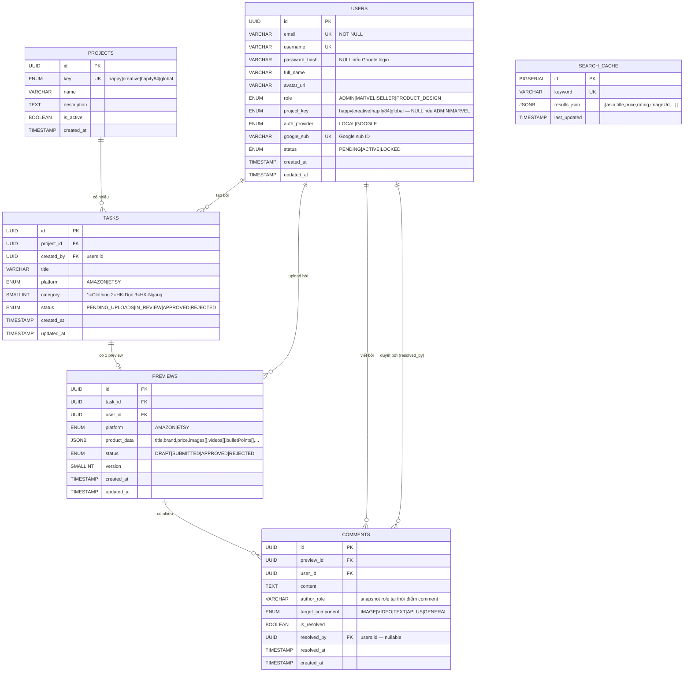

# ERD — Happy Creative Product Preview Tool

## Sơ đồ quan hệ (Mermaid)



---

## Quan hệ chi tiết

| Quan hệ | Loại | Mô tả |
|---------|------|-------|
| `PROJECTS` → `TASKS` | 1 : N | Một project có nhiều task |
| `USERS` → `TASKS` | 1 : N | Một user (Seller/Admin) tạo nhiều task |
| `TASKS` → `PREVIEWS` | 1 : 1 | Một task có đúng 1 preview (version mới nhất) |
| `USERS` → `PREVIEWS` | 1 : N | Một user có thể tạo nhiều preview (các lần update) |
| `PREVIEWS` → `COMMENTS` | 1 : N | Một preview có nhiều comment |
| `USERS` → `COMMENTS` | 1 : N | Một user viết nhiều comment |

---

## Phân quyền theo dữ liệu

```
ADMIN
  └── Thấy tất cả PROJECTS → TASKS → PREVIEWS → COMMENTS

MARVEL
  └── Thấy tất cả PROJECTS → TASKS → PREVIEWS → COMMENTS
  └── Chỉ edit vùng VIDEO (target_component = VIDEO)

SELLER (project_key = 'happy')
  └── PROJECTS.key = 'happy' → TASKS của project đó
  └── Edit vùng TEXT (target_component = TEXT)
  └── Comment vào mọi thành phần

PRODUCT_DESIGN (project_key = 'creative')
  └── PROJECTS.key = 'creative' → TASKS của project đó
  └── Edit vùng IMAGE, APLUS (target_component = IMAGE | APLUS)
  └── Comment vào mọi thành phần
  └── Không tạo được TASKS mới
```

---

## Cấu trúc JSONB — product_data

```json
{
  "title":            "Hanes Men's Undershirts (3-Pack)",
  "brand":            "Hanes",
  "price":            14.99,
  "description":      "Mô tả sản phẩm đầy đủ...",
  "fabricType":       "100% Cotton",
  "careInstructions": "Machine wash cold, tumble dry low",
  "origin":           "Imported",
  "bulletPoints": [
    "Tagless design for itch-free comfort",
    "Ribbed fabric for durability",
    "Classic crew neck style"
  ],
  "images":    ["https://cdn.../img1.jpg", "https://cdn.../img2.jpg"],
  "videos":    ["https://cdn.../demo.mp4"],
  "aPlusImages": ["https://cdn.../aplus1.jpg"],
  "colors":    ["White", "Black", "Gray"],
  "sizes":     ["S", "M", "L", "XL", "2XL"]
}
```

**Giới hạn media:**
| Platform | Ảnh tối đa | Video tối đa |
|----------|-----------|-------------|
| Amazon   | 7         | 1           |
| Etsy     | 20        | 1           |

---

## Cấu trúc JSONB — search_cache.results_json

```json
[
  {
    "asin":        "B01234ABCD",
    "title":       "Competitor Product Title",
    "price":       "19.99",
    "rating":      4.5,
    "reviewCount": 1234,
    "imageUrl":    "https://m.media-amazon.com/...",
    "productUrl":  "https://www.amazon.com/dp/B01234ABCD"
  }
]
```

Cache hết hạn sau **24 giờ** — `PreviewCleanupService` xóa các record `last_updated < NOW() - INTERVAL '24 hours'`.

---

## Cách dùng

```bash
# Chạy 1 lần để khởi tạo toàn bộ DB từ đầu
psql -U dev -d productpreview -f database/init.sql
```
